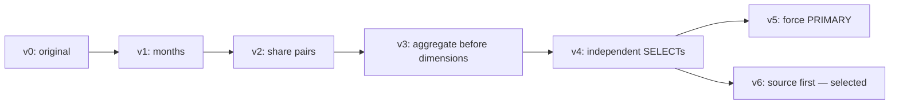

# Query 39 — step-by-step optimization

Selected version: [query39_v6_sourcefirst.sql](query39_v6_sourcefirst.sql).
[query39_BEST.sql](query39_BEST.sql) contains exactly the same SQL.
The selection includes a correction for a bad plan under the indexed design.

## What the query must return

For each warehouse/item pair, calculate the inventory quantity's **coefficient
of variation**, `STDDEV_SAMP(quantity) / AVG(quantity)`, for April and May 1998.
Both months must satisfy the original coefficient threshold greater than 1.
The alias `cov` means coefficient of variation here, not covariance.

The file contains **two independent SELECT statements**. The first returns the
qualifying month pairs; the second additionally requires April's coefficient
to exceed 1.5. Their local outputs have **141 rows and 2 rows**, respectively.
Each output has ten columns, including repeated column names. Treating this as
one 143-row result loses part of the original interface.

## Conditions for these comparisons

All timings below are saved **local preliminary measurements**, obtained on
14 October 2026: MariaDB 10.11.14, Ubuntu/Linux, Ryzen 5 3500U, 6.7 GiB RAM,
generator SF=1 and data seed 10. The InnoDB buffer pool was 2 GiB; temporary-table
and heap-table limits were 16 MiB. The machine had substantial swap use.

`pk` means primary keys only. `reference` means those primary keys plus all
117 secondary indexes from the repository. The SQL rewrites add no indexes.
Each ordinary timing group has three serial runs after exploratory executions
or warm-ups, with the query cache disabled. Times include client connection,
session setup, execution and complete result transfer. Diagnostics and fixtures
are excluded. Speedup = original median / candidate median **within the same
series and configuration**. No controlled cold-cache reset was performed.

The final benchmark is planned on Hossein's computer. These Linux results must
be repeated there and at the four agreed scales; they are not measurements of
that final machine. See the [measurement protocol](../../../experiments/README.md#run-controlled-comparisons)
for ordering details and limitations.

## Version-by-version comparison

| Version | Change from its parent | Role |
| --- | --- | --- |
| [v0](query39_v0.sql) | Original two SELECTs; dimensions joined before aggregation | Baseline |
| [v1](query39_v1_monthfilter.sql) | v0 + explicit April/May restriction | Filter-only attempt |
| [v2](query39_v2_sharedtemp.sql) | Share qualifying month pairs in a temporary table | Reuse-only attempt; slower |
| [v3](query39_v3_latedimensions.sql) | v2 + aggregate inventory before dimension lookups | Fast shared-results alternative |
| [v4](query39_v4_independent.sql) | Keep late lookups, restore independent SELECT statements | Initial candidate; indexed plan problem |
| [v5](query39_v5_primary.sql) | v4 + force inventory's PRIMARY access path | Indexed correction alternative |
| [v6](query39_v6_sourcefirst.sql) | v4 + keep grouped source before dimensions in join order | Selected indexed correction |

v5 and v6 are **alternative branches from v4**. v6 does not retain v5's
`FORCE INDEX`; it changes the join-order constraint instead.



### Step 0 — v0: measure the original inventory work

Both SELECTs repeat the inventory statistics. Within a SELECT the `inv` CTE
is referenced for April and May. Item and warehouse details are looked up while
processing raw observations, before those observations have been grouped.

The saved actual plan for the **first SELECT** reads 225,000 April observations
and 180,000 May observations, with **405,000 item lookups** in total.
The primary-key median for the complete two-SELECT file is **3.280 s**.
These plan counts describe one SELECT; the timing describes the whole file.

### Step 1 — v1: restrict the aggregation to the requested months

Add the following inside both copies of the aggregation:

```sql
AND d_moy IN (4,5)
```

The hypothesis is to exclude unused months before grouping. The original plan
already receives useful month predicate pushdown from its outer references,
so this does little: **3.280 to 3.226 s (1.02×)**. Results match exactly.
Retain the attempt as evidence that moving an existing filter is not always
the main opportunity.

### Step 2 — v2: share month pairs across the two outputs

Build `riccio_q39_pairs` once with `CREATE TEMPORARY TABLE ... ENGINE=InnoDB AS`.
Pivot April and May statistics into one row per warehouse/item, then read that
table for the two outputs and drop it. Creation, population, both reads and
cleanup are all included in the measured interval.

This attempts to avoid repeating the same statistics, but **still joins item
and warehouse before grouping**. Its actual build plan performs 405,000 item
lookups. The primary-key median is **3.881 s**, slower than v0's 3.280 s
(0.85× speedup). Temporary-table reuse alone did not pay for its extra work in
this experiment; retain it as a rejected performance attempt.

### Step 3 — v3: aggregate before looking up dimension details

Keep v2's shared output table, but first group `inventory` and `date_dim` by
warehouse key, item key and month. Join `item` and `warehouse` after computing
the original sample standard deviation and mean. Apply the original coefficient
predicates and build the month pairs from these smaller results.

The actual build plan now performs **5,235 item lookups**, while still reading
405,000 inventory observations. The complete-file median becomes **0.769 s**:
**5.05× vs v2** and **4.27× vs v0**. This comparison supports moving dimension
work after aggregation as the useful change, rather than attributing the whole
gain to temporary-table sharing.

The shared result is one computation reused by both outputs. That assumes data
are unchanged between them. The original independent statements can observe
separate database states, depending on transaction isolation and concurrent
updates. This distinction matters before refresh/concurrent-workload testing.

### Step 4 — v4: keep the late joins but restore independent statements

Remove the shared temporary table. Each original SELECT receives the late-join
aggregation and keeps its original statement boundary and output structure.
Its primary-key median is **0.818 s (4.01× vs v0)**. These three trials were
added after the main primary-key series, rather than interleaved with fresh
original trials, so the small difference from v3 is not a precise overhead
estimate. v4 was preferred at that point for its independent outputs.

Adding the reference indexes exposes another problem: v4's indexed median is
**44.234 s**, against an indexed v0 median of **80.035 s**. Its saved indexed
`EXPLAIN` shows `lateral: 1` materializations driven by warehouse/item, using
`idx_inv_warehouse_sk` and `idx_inv_item_sk`. The date filter is reached later
in those accesses. Late joins in the SQL text did not guarantee the desired
physical execution order.

### Step 5 — v5: test a PRIMARY-path correction

Branch from v4 and add this to each inventory source:

```sql
FROM inventory FORCE INDEX (PRIMARY)
```

The PRIMARY key begins with the date key. The saved indexed plan returns to
`date_dim` followed by inventory PRIMARY lookups and has no lateral
materializations. With fresh original control runs, the complete-file median
is **0.867 s**, versus **81.236 s** for v0 in this new series: **93.72×**.
This is a successful alternative, but it explicitly names an access path.

### Step 6 — v6: constrain the grouped source's join order

Branch from v4 again, keeping its ordinary inventory source. Inside each `inv`
CTE, replace the dimension joins with:

```sql
FROM inv_raw
STRAIGHT_JOIN item ON inv_item_sk = i_item_sk
STRAIGHT_JOIN warehouse ON inv_warehouse_sk = w_warehouse_sk
```

This keeps the grouped source before its dimension lookups without naming an
index. The saved plan uses date_dim then inventory PRIMARY by `inv_date_sk`,
with no lateral materializations. In the actual first-SELECT plan, item lookups
are **2,170 for April and 141 for May**, or **2,311** in total.

The fresh-series median is **0.817 s**, versus **81.236 s** for v0 and **0.867 s**
for v5. Its 99.44× gain is against that slow indexed original. The v5/v6 median
ratio is only about 1.06×; the large finding is avoiding the bad indexed plan,
not a claim that the small v5/v6 difference is universal. v6 keeps independent
statements and avoids a named index, so it is the selected MariaDB candidate.
`STRAIGHT_JOIN` is still a database-specific optimizer constraint to recheck
on every configuration.

## Complete timing comparisons

### Primary-key series

| Version | n | Median (s) | Min–max (s) | Speedup vs same-series v0 |
| --- | ---: | ---: | ---: | ---: |
| [v0](query39_v0.sql) | 3 | 3.280 | 3.177–3.479 | 1.00× |
| [v1](query39_v1_monthfilter.sql) | 3 | 3.226 | 3.176–3.229 | 1.02× |
| [v2](query39_v2_sharedtemp.sql) | 3 | 3.881 | 3.878–3.881 | 0.85× |
| [v3](query39_v3_latedimensions.sql) | 3 | 0.769 | 0.768–0.818 | 4.27× |
| [v4](query39_v4_independent.sql) | 3 | 0.818 | 0.817–0.917 | 4.01× |

v5 and v6 have **no separate full-scale primary-key repetition series** in this
archive. Their indexed times must not fill those missing cells by inference.

### First indexed series: v0 versus v4

| Version | n | Median (s) | Min–max (s) | Speedup vs same-series v0 |
| --- | ---: | ---: | ---: | ---: |
| [v0](query39_v0.sql) | 3 | 80.035 | 79.887–84.667 | 1.00× |
| [v4](query39_v4_independent.sql) | 3 | 44.234 | 43.781–50.320 | 1.81× |

### Fresh indexed correction series: v0, v5 and v6

| Version | n | Median (s) | Min–max (s) | Speedup vs same-series v0 |
| --- | ---: | ---: | ---: | ---: |
| [v0](query39_v0.sql) | 3 | 81.236 | 81.092–83.618 | 1.00× |
| [v5](query39_v5_primary.sql) | 3 | 0.867 | 0.817–0.867 | 93.72× |
| [v6](query39_v6_sourcefirst.sql) | 3 | 0.817 | 0.816–0.817 | 99.44× |

Both indexed series have the same physical index set, but different control
runs. The final speedups use **81.236 s**, not 80.035 s and not the 3.280 s
primary-key baseline. Do not pool the controls or present 99× as an intrinsic
improvement over every original plan.

## Plan evidence: distinguish the work being counted

| Diagnostic | Unit inspected | Inventory observations | Item lookups |
| --- | --- | ---: | ---: |
| Original, pk | First SELECT | 405,000 | 405,000 |
| v2, pk | Shared-table build SELECT | 405,000 | 405,000 |
| v3, pk | Shared-table build SELECT | 405,000 | 5,235 |
| v6, indexed | First SELECT | 405,000 | 2,311 |

These are actual `r_rows`/`r_loops` observations, with each unit explicitly
named. A build shared across outputs and an independent first SELECT are not
the same workload unit. Estimated `rows` from an EXPLAIN are not substituted
for actual counts.

## Why the rewrites preserve the answer

The original `STDDEV_SAMP`, `AVG`, zero-mean handling, coefficient predicates
and two ordered outputs remain. A sample standard deviation must not be replaced
with the population function. A single observation or all-NULL group can produce
NULL statistics; those conditions retain their original behavior.

Late aggregation retains both inner dimension joins: orphan item/warehouse
groups still disappear. Item and warehouse primary keys make the late lookup
one-to-one. Grouping by warehouse key preserves separate warehouses that happen
to share a name. The shared versions require both qualifying month groups through
`COUNT(DISTINCT d_moy)=2`; the independent versions retain the original month
self-join. v4/v5/v6 retain the original independent SELECT boundaries.

## Compare the returned results

The comparison checks complete ordered values, column names, duplicate
columns, NULLs and result-set boundaries; equal row counts alone are
insufficient. `LIMIT`, where present, remains part of the original query.

| Version | Rows per result set on SF=1 | Full output comparison |
| --- | --- | --- |
| [v0](query39_v0.sql) | 141, 2 | Saved original |
| [v1](query39_v1_monthfilter.sql) | 141, 2 | 3/3 ordinary runs matched the original; timings remain separated by profile |
| [v2](query39_v2_sharedtemp.sql) | 141, 2 | 3/3 ordinary runs matched the original; timings remain separated by profile |
| [v3](query39_v3_latedimensions.sql) | 141, 2 | 3/3 ordinary runs matched the original; timings remain separated by profile |
| [v4](query39_v4_independent.sql) | 141, 2 | 6/6 ordinary runs matched the original; timings remain separated by profile |
| [v5](query39_v5_primary.sql) | 141, 2 | 3/3 ordinary runs matched the original; timings remain separated by profile |
| [v6](query39_v6_sourcefirst.sql) | 141, 2 | 3/3 ordinary runs matched the original; timings remain separated by profile |

For a concrete value comparison, the first returned row of result set 1
is shown below. The candidate is `query39_v6_sourcefirst.sql`. The complete
outputs, rather than only this example, were compared.

| Output column (position) | Original v0 | Selected v6 |
| --- | --- | --- |
| w_warehouse_sk (1) | `1` | `1` |
| i_item_sk (2) | `92` | `92` |
| d_moy (3) | `4` | `4` |
| mean (4) | `308.6000` | `308.6000` |
| cov (5) | `1.01159013` | `1.01159013` |
| w_warehouse_sk (6) | `1` | `1` |
| i_item_sk (7) | `92` | `92` |
| d_moy (8) | `5` | `5` |
| mean (9) | `376.0000` | `376.0000` |
| cov (10) | `1.06818258` | `1.06818258` |

Result set 2 was also compared in full. Its first warehouse/item pair is
`(1, 16960)` in both v0 and v6; matching result set 1 alone would not establish
that the extra April threshold was preserved.

The selected v6's nonempty fixture returns **3 and 2 baseline rows**, followed
by **3 and 2 identical candidate rows**. It covers both coefficient thresholds,
a missing month, zero/NULL means, a single observation, duplicate warehouse
names and orphan facts. Separate archived fixtures also test the shared and
other independent corrections. These fixtures establish tested equivalence,
not equivalence under every possible concurrent refresh schedule.

## Reproduce the selected comparison

Run from the repository root after following the [setup guide](../../../experiments/README.md#reproduce-on-a-fresh-database).
The example assumes a loaded dedicated `$TPCDS_DB`, SF=1, seed 10, and the 117
reference indexes physically present. `--profile reference` is a label and does
not create indexes. Choose a new session directory for each attempt.

```bash
python3 scripts/build_experiment_jobs.py \
  --queries 39 --profile reference --scale 1 --data-seed 10 --repeats 3 \
  --runs experiments/local/q39_review_reference/runs \
  --output experiments/local/q39_review_reference/jobs.json

python3 scripts/run_query_batch.py \
  --database "$TPCDS_DB" \
  --jobs experiments/local/q39_review_reference/jobs.json \
  --out experiments/local/q39_review_reference/runs

python3 scripts/summarize_experiments.py \
  --runs experiments/local/q39_review_reference/runs \
  --out experiments/local/q39_review_reference/summary
```

This runs discarded warm-ups followed by three alternating v0/v6 rounds.
It compares against a fresh local original, not an output copied from the Linux
machine. For another retained version, use the [manual comparison example](../../../experiments/README.md#compare-an-intermediate-version).
Repeat under `pk` only after verifying that secondary indexes are absent; keep
its results in a separate session. Preserve the same query parameters in both
versions at each scale.

## Evidence for the report

The [measurement CSV](../../../experiments/evidence/riccio_sf1_20261014/measurements.csv)
and [raw archive](../../../experiments/evidence/riccio_sf1_20261014/raw_trials.zip)
are committed. The [archive inspection instructions](../../../experiments/README.md#inspect-the-committed-evidence-without-a-database)
explain how to extract them without running MariaDB. Paths below are members
inside that archive:

| Evidence | Archive path |
| --- | --- |
| Original output example | `runs/q39_v0_pk_probe/result.json` |
| Selected output example | `runs/q39_v6_reference_q39_final_r1/result.json` |
| Original first SELECT, actual | `runs/q39_v0a_pk_analyze/plan_1.json` |
| Shared-only build, actual | `runs/q39_v2_build_pk_analyze/plan_1.json` |
| Late-join build, actual | `runs/q39_v3_build_pk_analyze/plan_1.json` |
| v4 indexed estimate | `runs/q39_v4_reference_explain/plan_1.json` |
| v5 indexed estimate | `runs/q39_v5_reference_explain/plan_1.json` |
| v6 indexed actual first SELECT | `runs/q39_v6_reference_analyze/plan_1.json` |

Ordinary labels ending in `_r1`, `_r2` and `_r3` contain `run.json`,
`input.sql`, `result.json`, raw `output.xml` and `stderr.txt`. The archived SQL
and SHA-256 hashes identify the version that was actually executed.

The selected `query39_BEST.sql` is an exact copy of the selected source,
not a separately measured implementation. For the final report, retain the
unsuccessful steps, state the configuration beside every timing, and repeat
correctness and performance checks on Hossein's machine and at each scale.

For original per-statement diagnostics, [query39a_v0.sql](query39a_v0.sql) and
[query39b_v0.sql](query39b_v0.sql) split the original file without changing its
statements. They are diagnostic inputs, not two additional candidate versions.
The archived `diagnostics/q39_v6_first.sql` similarly isolates v6's first SELECT.
Time the complete two-result file for ordinary comparisons.
